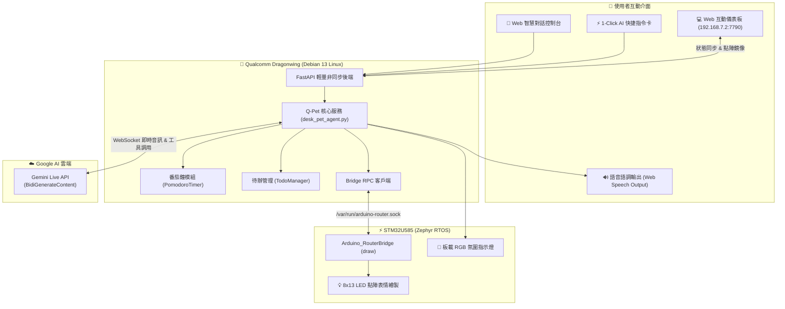

# Q-WorkMate / LumiPet 🐾
> **基於 Arduino UNO Q 雙核邊緣運算與 Gemini Live 之 AI 智慧桌面生產力桌寵**

[](https://store.arduino.cc/)
[-A81D33?logo=debian&logoColor=white)](https://www.debian.org/)
[](https://zephyrproject.org/)
[](https://ai.google.dev/)
[](https://opensource.org/licenses/MIT)

---

## 📖 專案簡介 (Overview)

**Q-WorkMate**（或稱 **LumiPet**）是一款深度融合硬體邊緣運算與雲端多模態大模型的智慧桌面互動桌寵。

傳統的智慧助理通常只存在於螢幕或冷冰冰的音響中，缺乏實體桌面的陪伴感；而傳統的電子寵物或番茄鐘又缺乏真正的自然語言理解與智慧管理能力。**Q-WorkMate** 充分利用 **Arduino UNO Q** 的**雙核心架構**（Qualcomm Dragonwing ARM64 應用處理器 + STM32U585 即時微控制器），將 **Gemini Live 雙向即時語音對話** 與 **板載 8x13 LED 矩陣動態表情**、**RGB 氛圍燈**、**番茄鐘專注管理** 及 **語音待辦備忘錄** 完美整合，打造兼具「生產力助理」與「情緒價值桌寵」的次世代 AIoT 桌面伴侶。

---

## ✨ 核心特色與亮點 (Key Features)

### 1. 🧠 雙核心異質架構 (Dual-Brain Heterogeneous Architecture)
- **Linux 邊緣運算層 (Qualcomm ARM64)**：負責跑 Docker、FastAPI、WebSocket 雙向即時音訊串流，對接 Google Gemini Live API，並提供 Function Calling 決策核心。
- **即時硬體控制層 (STM32U585 MCU + Zephyr RTOS)**：透過高效的 `Arduino_RouterBridge` RPC 介面，毫秒級驅動板載 8x13 矩陣，提供零延遲的流暢動畫與狀態顯示。

### 2. 🍅 智慧專注番茄鐘 (Pomodoro Focus Companion)
- **動態進度格條**：啟動專注計時後，板載 8x13 LED 矩陣會即時顯示時間流逝進度條，RGB 燈切換為熱血專注紅。
- **主動語音關懷**：專注結束後主動播放溫馨提醒：「主人，專注時間結束囉，起來伸展喝水吧！」，並切換為水杯圖示。

### 3. 📝 智慧隨手待辦備忘 (To-Do & Memo Assistant)
- 隨時在對話欄輸入：「幫我記一筆：明天中午交期中專題報告」，桌寵會即時調用 `add_todo` 工具寫入記憶清單並在板載點陣顯示打勾動畫（✔）。
- 輸入：「我今天有什麼待辦事項？」，桌寵會清晰條列列出目前事項。

### 4. 😊 擬人化動態表情與情緒反饋 (Dynamic Emotion Engine)
- **待命呼吸笑臉**：平時在桌面上每隔數秒自然眨眼微笑。
- **思考運算狀態**：AI 運算時點陣呈現 4 幀旋轉雷達波形。
- **情緒互動**：被誇獎或安慰主人時顯示「愛心眼 (♥_♥)」；休息時呈現「Zzz 睡覺呼嚕」動畫。

### 5. 💻 現代化 Web 雙向互動儀表板 (Web Dashboard)
- **虛擬點陣螢幕鏡像 (Matrix Mirror)**：網頁上 1:1 實時同步反映 UNO Q 上的實體 8x13 LED 像素。
- **雙向智慧互動**：支援文字指令對話、快捷 AI 指令卡與單鍵情緒手動測試。
- **即時語音生成與播放**：Gemini 生成語音回覆，可透過瀏覽器自動朗讀。
- **即時硬體遙測**：板載 CPU 溫度、可用記憶體、系統運作時長監控卡片。

---

## 🏗️ 系統架構圖 (System Architecture)



---

## 📁 專案檔案結構 (Project Structure)

```
.
├── desk_pet_agent.py      # 主程式：整合 Gemini Live、FastAPI、工具調用與 Web 儀表板
├── pet_matrix.py          # LED 點陣動畫引擎：背景執行緒、狀態情緒切換、Bridge RPC 調用
├── matrix_frames.py       # 8x13 點陣表情圖庫（笑臉、眨眼、愛心、旋轉思考、番茄鐘進度等）
├── productivity.py        # 生產力模組：番茄鐘計時器、待辦事項持久化管理、健康提醒
├── rgb_led.py             # 板載 RGB LED 驅動控制器
├── run_pet.sh             # 一鍵啟動容器腳本
├── .gitignore             # Git 忽略設定（嚴格排除金鑰與個資）
├── README.md              # 專案完整說明文件
├── DEMO_SCRIPT.md         # 示範影片分鏡錄製腳本
└── SLIDES_OUTLINE.md      # 專題簡報投影片內容大綱
```

---

## 🚀 快速開始 (Quick Start)

### 1. 前置準備
- 將 **Arduino UNO Q** 透過 USB-C 連接至電腦。
- 電腦端啟動 ADB 連線並轉發通訊埠：
  ```bash
  adb forward tcp:7790 tcp:7790
  ```

### 2. 啟動 MCU 端 LED 點陣服務
在板上確認 `smile-matrix` sketch 已載入（提供 `draw` RPC 介面）：
```bash
arduino-app-cli app start user:smile-matrix
```

### 3. 設定 Gemini API Key
在 UNO Q 板上將您的 API Key 存入秘密檔案（此處不進入 git 且不留存歷史）：
```bash
read -s -p "請貼上 Gemini API Key: " K; printf %s "$K" > ~/.gemini_key; chmod 600 ~/.gemini_key; echo
```

### 4. 一鍵啟動 Q-WorkMate 桌寵
在板上的專案目錄下執行：
```bash
bash run_pet.sh
```

### 5. 開啟 Web 控制台
在電腦瀏覽器輸入：
👉 **`http://localhost:7790`**
- 按住畫面中央的「按住說話」按鈕（或直接按住電腦空白鍵）即可開始與桌寵對話！
- 也可直接在儀表板點選番茄鐘測試、新增待辦事項或切換表情。

---

## 🗣️ 常用語音指令範例 (Voice Commands)

| 意圖 | 建議語音範例 | 桌寵反應與硬體動作 |
| :--- | :--- | :--- |
| **啟動番茄鐘** | *「幫我設定 1 分鐘專注模式」* | 點陣顯示進度倒數格條，RGB 亮紅色，開始背景計時。 |
| **查詢剩餘時間** | *「專注時間還剩多久？」* | 語音告知剩餘分秒，點陣同步更新。 |
| **取消計時** | *「取消專注計時」* | 停止計時，點陣恢復眨眼微笑，RGB 恢復待命綠。 |
| **新增待辦事項** | *「幫我記一下：下午四點跟同學開會」* | 寫入待辦清單，點陣閃爍 ✔️ 打勾符號，語音確認。 |
| **查詢待辦清單** | *「我現在有哪些待辦事項？」* | 桌寵依序列出事項，並顯示在網頁清單。 |
| **標記事項完成** | *「第 1 項做完了」* | 標記完成並劃掉，點陣顯示打勾圖示。 |
| **情緒安慰 / 誇獎** | *「小寵你今天好可愛」 / 「我好累」* | 點陣立刻變出 **愛心眼 (♥_♥)**，RGB 亮粉紅光並給予加油。 |
| **查詢板子狀態** | *「你現在會熱嗎？」 / 「板子狀態如何？」* | 呼叫工具即時讀取 CPU 溫度與負載並自然口語回報。 |
| **查詢時間** | *「現在幾點幾分？」* | 語音回報台灣當前日期、時間與星期幾。 |

---

## 🛡️ 安全性與隱私規範 (Security & Privacy)

本專案嚴格遵循期中專題規範：
- 程式碼、設定檔及 Git 歷程中**絕不包含任何 API 金鑰或密碼**。
- 金鑰均透過獨立本機檔案掛載，並列入 `.gitignore` 排除。
- 專案 Repo 名稱與程式內皆未洩漏學生姓名或學號資訊。

---

## 📜 授權協議 (License)

本專案採用 [MIT License](LICENSE) 授權。
